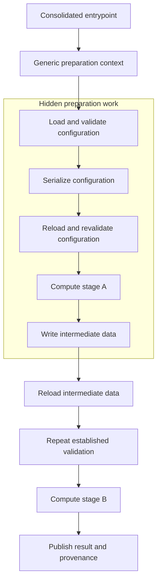
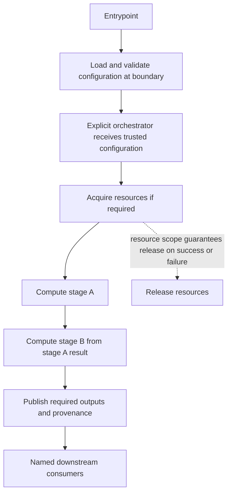

# Design a Coherent Refactor

## Goal

Resolve an authorized design problem across its affected workflow, preserving required behavior and reducing complexity in the resulting system.

## Preconditions

Read [[Refactoring Simplifies the Whole Workflow]] and the relevant domain principles. Establish the requested scope, project standards, and available evidence. A review authorizes recommendations; it does not by itself authorize implementation or deployment.

For substantial refactors or materially unclear requirements, follow [Define an Implementation Spec](Define%20an%20Implementation%20Spec.md), reusing the agreed outcome when available. Implement coherently without preserving speculative PR separation. When PR preparation is requested, use [Prepare and Create Pull Requests](Prepare%20and%20Create%20Pull%20Requests.md) after implementation to establish and verify delivery boundaries.

## Steps

1. **Trace before editing.** Follow entrypoints and relevant callers through configuration loading, validation, data production, computation, persistence, provenance, and side effects to every affected consumer, including later commands and automation. Inspect tests and operational documentation. Record unresolved contracts rather than assuming an intermediate artifact is unused.
2. **Separate contracts from structure.** Identify required outputs, errors, ordering, configuration semantics, artifact identity, compatibility, and resource lifetimes. For existing helpers, schemas, adapters, intermediate files, and context managers, state which requirement each serves.
3. **Design the target flow.** Describe responsibilities, inputs, outputs, and ownership independently of current files. Keep computational stages explicit and resource scopes limited to actual lifecycle obligations. Draw a flowchart when sequencing or ownership is complex; choose file boundaries afterward.
4. **Compare credible alternatives.** When a local correction and broader coherent refactor differ materially, compare both using the criteria below. A routine change with one clearly sufficient design needs only a brief rationale, not invented alternatives.
5. **Implement the authorized design completely.** Update affected callers, tests, documentation, commands, and automation; remove obsolete paths. Preserve supported interfaces where required, with evidence for any compatibility adapter. A wrapper or relocation is complete only if it actually resolves the identified cause.
6. **Verify behavior and architectural improvement.** Use [[Verify a Change Against Quality Principles]] and the checklist below. Explain retained complexity and report incomplete work, unrun checks, and residual risks.

## Ranking and design selection

Use this rubric across discovery and domain playbooks. Score verified finding/proposal pairs separately from 1 to 5; do not add a minimality score or use a summed score to select the design.

Merge overlapping findings across routes before prioritizing; repeated evidence for one cause does not multiply its severity. A justified retained design or a route with no verified finding is unscored, not a low-scoring defect.

| Score | Criticality: demonstrated impact of the problem | Architectural improvement: quality of the resulting design | Refactor leverage: reach of the resolved cause |
| --- | --- | --- | --- |
| 1 | Cosmetic issue with no demonstrated contract impact | Cosmetic or relocation-only change | One incidental symptom |
| 2 | Local maintenance friction with low runtime impact | Removes local noise but leaves the main design problem | One local responsibility |
| 3 | Obscures central behavior or makes changes error-prone | Clarifies a responsibility or removes a needless boundary | Several related checks or call sites |
| 4 | Can produce misleading results or skip required behavior | Resolves the affected workflow's design problem with clear ownership | Multiple stages or consumers of the same cause |
| 5 | Can violate critical correctness, consequential side-effect, or availability contracts | Clear end-to-end flow with unnecessary state, coupling, and handoffs eliminated | A shared contract removes the cause across all affected workflows |

Prioritize demonstrated contract failures, then architectural improvement and leverage. Scores require contextual evidence, not hypothetical severity or a count of edited files. A highly leveraged change is not permission to expand the authorized scope.

For materially different alternatives, record correctness and contract preservation, clarity of responsibilities, duplication, coupling, operational cost (including I/O and memory), migration risk, and verification effort. Record implementation cost separately, including patch size where informative. Reject alternatives that violate required contracts. Among comparably correct options, prefer the clearest and simplest supported design; prefer lower cost and risk when architectural outcomes are materially equivalent. If a constraint rules out the stronger design, make that limitation and remaining debt explicit.

## Conditional delegation

Delegate when independent investigation or separable work adds useful evidence and the coordination cost is justified. Small tasks alone do not guarantee better results.

- An explorer can trace the workflow, identify contract evidence and uncertainties, and compare alternatives. Hand off the current flow, target proposal, relevant callers/consumers, evidence locations, and acceptance criteria.
- Agree on the target flow before an implementer changes dependent code. The implementer checks the handoff against the code and raises conflicting evidence rather than blindly following it.
- Keep one integrating owner accountable for design decisions, shared contracts, completion, and verification. Parallelize independent investigations or disjoint implementation work; do not divide tightly coupled architectural decisions merely by file. Avoid concurrent edits to shared files.
- Use an independent verification pass when valuable. Give it the request, relevant guidance, and raw artifacts without the desired verdict. A simple local correction may be better handled by one agent.

## Example: CPO workflow

This is an illustrative reconstruction of the supplied CPO account, not an independently audited implementation. Stage names below are schematic. Assume two consecutive computations run in one process and the intermediate files have no required external consumer or restart contract; verify those assumptions in real code.

### Before: consolidation without architectural completion

Shared orchestration reduces duplicated entrypoint code but retains unnecessary configuration and disk dependencies. Calling the preparation scope still conceals a major computational stage.

### After: explicit responsibilities and direct handoffs

Pass validated settings and stage results directly where contracts permit. Record effective configuration and input identities for provenance without requiring the current computation to reload that record. Keep required publication at its established point in the workflow; a failed publication still fails the request when publication is required. The resource scope encloses the work for cleanup, but its entry/exit methods do not perform stage A or B.

| Case | Decision and evidence |
| --- | --- |
| Justified small refactor | Remove one redundant configuration serialization/reload when the surrounding workflow already has clear ownership and all required artifacts. Verify effective configuration semantics and consumers; no wider redesign is needed. |
| Incomplete refactor | Reject a completion claim based only on a common wrapper or relocation when unnecessary reloads, repeated checks, hidden stages, or obsolete callers remain. Name the unresolved causes. |
| Justified retained complexity | Keep a checkpoint required for restart, an artifact consumed by another process, or validation at a new trust boundary. Identify the consumer/invariant and test that requirement. Mutation that can invalidate an earlier invariant also warrants renewed validation. |

## Verification checklist

- [ ] Representative and boundary inputs preserve required outputs, ordering, tolerances, errors, and supported entrypoint behavior.
- [ ] Configuration defaults, overrides, normalization, and invalid-input failures remain correct. Trusted in-process settings no longer require an unnecessary serialization/reload round trip.
- [ ] Each major computation is explicit in the target flow, executes in the required order, and passes its result to the intended consumer. A failed stage prevents dependent work through the established failure contract.
- [ ] Boundary-level I/O evidence shows removed handoffs are absent on the affected path; required artifacts still satisfy schemas, content, timing, identity, and consumer compatibility. Account for precision or type changes formerly introduced by serialization.
- [ ] Provenance identifies effective configuration and selected inputs/results. A later consumer cannot confuse stale or partial artifacts with a successful current run.
- [ ] Resource acquisition/release and any transaction semantics hold on success and failure; lifecycle entry/exit does not hide major computation.
- [ ] Repeated validation is removed only where the invariant remains established; new inputs, mutation, and consequential side-effect boundaries retain required checks.
- [ ] Affected callers, tests, documentation, and automation use the target contracts; obsolete paths are removed or have a documented compatibility obligation.
- [ ] Every retained reload, duplicated state representation, adapter, or persistence handoff has a concrete justification. Repository-standard checks and focused architectural evidence are recorded.

Use public behavior, boundary spies, integration checks, or a reviewed responsibility/data-flow trace as appropriate. Do not lock tests to private helper names or source-file layout. Old tests passing establishes only the behavior those tests cover.

## Failure handling

If unavailable evidence or a migration constraint prevents completion, state what remains, why, its effect on consumers, and the next required step. Stage work when a concrete risk requires it, with explicit completion criteria; do not automatically defer rewiring because it spans modules. Do not call consolidation, renaming, or a transitional wrapper architectural completion while the original cause remains.

## Related

- [[Refactoring Simplifies the Whole Workflow]]
- [[Validated Configuration Loader]]
- [[Transactional Unit of Work]]
- [[Focused Test Matrix]]
- [[Verify a Change Against Quality Principles]]
